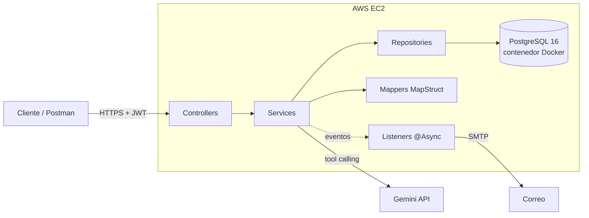
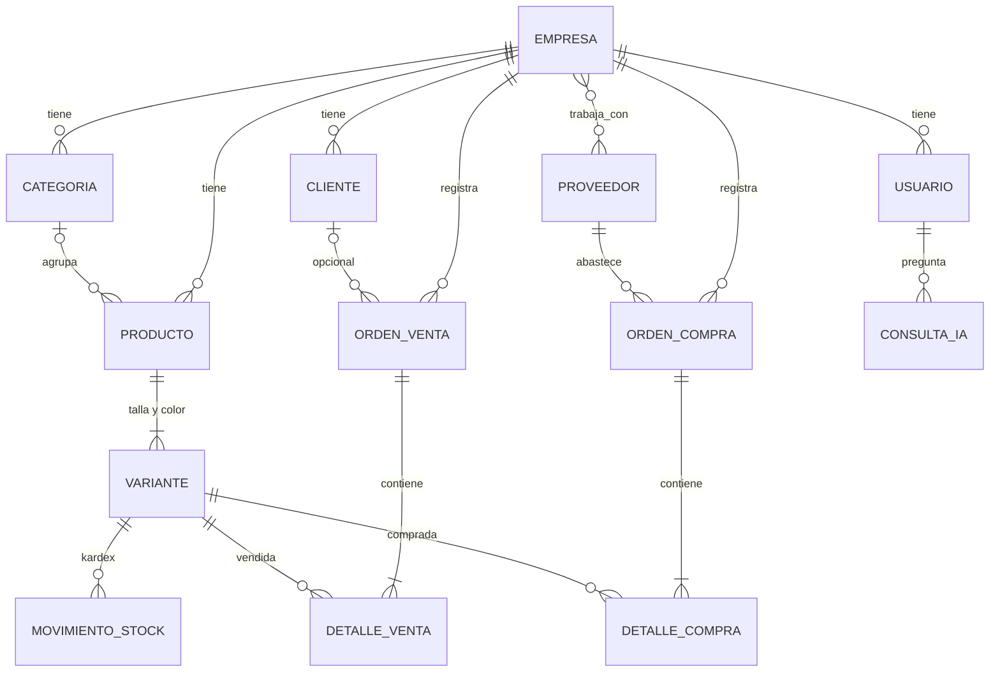

# Tienda Clara: ERP con asistente de IA para minoristas de Gamarra

**Curso:** CS 2031 Desarrollo Basado en Plataforma

**Integrantes:**
- Gabriel Murillo Machicao
- Héctor Sebastián Choque Dueñas
- Javier Bravo Chávez
- Rafael Vargas Portocarrero
- Indira Shian Yábar Ramos

---

## Índice

1. [Introducción](#introducción)
2. [Identificación del Problema o Necesidad](#identificación-del-problema-o-necesidad)
3. [Descripción de la Solución](#descripción-de-la-solución)
4. [Modelo de Entidades](#modelo-de-entidades)
5. [Mapeo entidad–DTO con MapStruct](#mapeo-entidaddto-con-mapstruct)
6. [API REST](#api-rest)
7. [Manejo de Errores](#manejo-de-errores)
8. [Medidas de Seguridad Implementadas](#medidas-de-seguridad-implementadas)
9. [Eventos y Asincronía](#eventos-y-asincronía)
10. [GitHub & Management](#github--management)
11. [Ejecución local y despliegue](#ejecución-local-y-despliegue)
12. [Conclusión](#conclusión)
13. [Apéndices](#apéndices)

---

## Introducción

### Contexto
Gamarra (La Victoria, Lima) es el emporio textil más grande del Perú, con miles de minoristas que venden en su puesto y por WhatsApp, Instagram o TikTok. Manejan el mismo modelo en muchas tallas y colores, cobran en efectivo, Yape o Plin, y compran constantemente a talleres y mayoristas.

### Objetivos del Proyecto
- Registrar catálogo, inventario, compras y ventas de cada negocio.
- Controlar el stock a nivel de **talla y color**, con un historial (kardex) de cada movimiento.
- Calcular la **ganancia real** de cada venta, considerando el costo y las rebajas por regateo.
- Ofrecer reportes para las decisiones del día a día.
- Incorporar un **asistente de IA** que explique esos datos en lenguaje sencillo, sin mezclar información entre negocios.

## Identificación del Problema o Necesidad

### Descripción del Problema
El minorista suele llevar su negocio en cuadernos o de memoria. Sabe cuánto vendió en el día, pero no qué modelo le deja más ganancia, qué talla se le acaba primero, cuánto pierde en rebajas o qué mercadería no rota. Así repone a ciegas, se queda sin las tallas que más salen y tiene dinero inmovilizado.

### Justificación
Estos negocios operan con márgenes pequeños: una mala compra impacta directamente en su liquidez. Los ERP existentes son caros o pensados para empresas grandes. Un sistema simple, adaptado a Gamarra y con un asistente que traduzca los números a recomendaciones, permite decidir con datos sin conocimientos técnicos.

## Descripción de la Solución

### Funcionalidades Implementadas
| Módulo | Qué resuelve |
|---|---|
| **Empresas, usuarios y roles** | Cada negocio se registra y su dueño (ADMIN) crea las cuentas de sus empleados (EMPLEADO). Toda la información queda aislada por empresa. |
| **Catálogo** | Categorías, productos (modelos) y **variantes por talla y color**, con precio de lista y costo. Se usa borrado lógico para no perder historial. |
| **Inventario y kardex** | Entradas, salidas, devoluciones y ajustes por conteo físico. Cada movimiento guarda el stock anterior y el resultante. |
| **Compras** | Órdenes a proveedores que suman stock automáticamente. |
| **Ventas** | Ventas con medio de pago y canal. El cliente es opcional. Descuentan stock y guardan el precio de lista y el costo del momento, para calcular ganancia y descuento reales. |
| **Reportes** | Resumen del periodo (ventas, ganancia, margen, ticket promedio), ranking de productos, ventas por medio de pago, canal, categoría, día u hora, stock bajo y stock parado con el capital inmovilizado. |
| **Asistente de IA** | `POST /api/v1/assistant`: responde preguntas como *"¿Qué me conviene reponer?"* usando solo los reportes del negocio del usuario. Tiene límite diario e historial. |
| **Notificaciones por correo** | Bienvenida al registrarse, alerta de stock bajo (por venta o salida manual), confirmación de compras, aviso al dueño de ajustes de inventario y cambios de precio, constancia de compra al cliente y aviso al empleado cuya cuenta se elimina. |

### Tecnologías Utilizadas
- **Lenguaje y framework:** Java 21, Spring Boot 4.1 (Web MVC, Data JPA, Validation, Security, Mail)
- **Base de datos:** PostgreSQL 16 en un contenedor Docker (Docker Compose), tanto en desarrollo como en la instancia EC2 de producción
- **Seguridad:** Spring Security, JWT (jjwt 0.12), BCrypt
- **IA:** Spring AI 2.0 con **Google Gemini 2.5 Flash** (API externa) y *tool calling*
- **Correo:** JavaMailSender (SMTP) con plantillas **Thymeleaf**
- **Despliegue:** AWS EC2 (Amazon Linux)
- **Mapeo y paginación:** MapStruct 1.6 para entidad–DTO y Spring Data `Pageable` en todos los listados
- **Otros:** Lombok, Maven, Docker, GitHub Actions, JUnit 5 y Mockito, Postman

### Arquitectura



## Modelo de Entidades



### Descripción de Entidades
| Entidad | Atributos principales | Relaciones |
|---|---|---|
| `EnterpriseModel` | RUC (único), razón social, fecha de registro | N:M con proveedores. Es la raíz de todos los datos del negocio. |
| `UserModel` | nombre, email (único), contraseña (BCrypt), rol | N:1 con empresa. Implementa `UserDetails`. |
| `SupplierModel` | RUC, razón social, contacto | N:M con empresas |
| `ClientModel` | documento (DNI/RUC, único por empresa), nombre, contacto | N:1 con empresa |
| `CategoryModel` | nombre (único por empresa), descripción, activo | N:1 con empresa |
| `ProductModel` | código (único por empresa), nombre, precio de compra, precio de venta, activo | N:1 con empresa y categoría; 1:N con variantes (`cascade = ALL`, `orphanRemoval`) |
| `ProductVariantModel` | talla, color, SKU, stock, stock mínimo, `@Version` | N:1 con producto (único por producto, talla y color) |
| `StockMovementModel` | tipo (ENTRADA, SALIDA, DEVOLUCION, AJUSTE), cantidad, stock anterior y resultante, motivo | N:1 con variante y, opcionalmente, con la orden que lo originó |
| `PurchaseOrderModel` / `PurchaseOrderLineModel` | fecha, estado, total / cantidad, precio | N:1 con empresa y proveedor; 1:N con detalles |
| `SalesOrderModel` / `SalesOrderLineModel` | fecha y hora, estado, medio de pago, canal, total / cantidad, precio cobrado, precio de lista, costo | N:1 con empresa y cliente (opcional); 1:N con detalles |
| `AiQueryModel` | pregunta, respuesta, exitosa, fecha | N:1 con usuario (`LAZY`, `ON DELETE CASCADE`) y con empresa |

Las restricciones se aplican en la base de datos (`nullable`, `unique`, `@UniqueConstraint` compuestas por empresa, `precision/scale` en los montos e índices en las claves ajenas más consultadas) y en la aplicación (`@Valid`, `@NotBlank`, `@Size`, `@Min`, `@Email`, `@Pattern`, `@DecimalMin`). Las relaciones `@ManyToOne` usan `fetch = LAZY` (salvo la empresa del usuario, que se necesita en cada request) y las consultas de reportes usan `JOIN FETCH` para evitar el problema N+1. Las reglas de negocio viven en las entidades; por ejemplo, `ProductVariantModel.decreaseStock()` impide vender más de lo que hay.

## Mapeo entidad–DTO con MapStruct

Las entidades nunca salen de la capa de servicio: los controllers reciben DTOs de request y devuelven DTOs de respuesta (`record`). La conversión la hacen **mappers de MapStruct** (paquete `mappers`), que generan el código en tiempo de compilación, sin reflexión:

| Mapper | Qué convierte |
|---|---|
| `ProductMapper` | `ProductModel` → `ProductResponseDTO` (aplana categoría y empresa, calcula `stockTotal`); `ProductDTO` → entidad para PUT y `ProductPatchDTO` → entidad para PATCH (ignora los `null`) |
| `ProductVariantMapper` | Variante → DTO (incluye `stockBajo`); request → entidad sin tocar el stock, que solo cambia por el kardex |
| `SalesOrderMapper`, `PurchaseOrderMapper` | Orden y sus líneas en una sola llamada (la lista de detalles se mapea automáticamente) |
| `StockMovementMapper` | Movimiento del kardex con la descripción completa de la variante |
| `CategoryMapper`, `ClientMapper`, `SupplierMapper`, `UserMapper`, `EnterpriseMapper`, `AiQueryMapper` | Resto de recursos |

Todos comparten `CentralMapperConfig`: son beans de Spring (`componentModel = "spring"`) y usan `unmappedTargetPolicy = ERROR`, así que si un DTO de respuesta gana un campo y nadie lo mapea, **la compilación falla** en vez de devolver `null` en silencio. Los métodos `updateEntity` solo copian los campos editables: el id, la empresa, el stock y las fechas nunca se toman del request. Las entidades se siguen creando con sus constructores, que exigen los datos obligatorios, y las reglas de negocio (por ejemplo, validar que la categoría sea de la misma empresa) siguen en los services.

## API REST

Todos los recursos están versionados bajo `/api/v1` y en plural. Requieren
`Authorization: Bearer <token>`, salvo el registro, el login, la renovación de token y
la creación de una empresa nueva.

| Recurso | Operaciones |
|---|---|
| `/auth` | `POST /register`, `POST /login`, `POST /refresh` |
| `/enterprises` | `POST`, `GET /{id}` |
| `/users` | `POST`, `GET`, `GET /me`, `DELETE /{id}` |
| `/categories` | `POST`, `GET`, `GET` · `PUT` · `DELETE /{id}` |
| `/products` | `POST`, `GET`, `GET` · `PUT` · `PATCH` · `DELETE /{id}` |
| `/products/{id}/variants` | `POST`, `GET` |
| `/variants/{id}` | `GET`, `PUT`, `DELETE` |
| `/clients` | `POST`, `GET`, `GET` · `PUT` · `DELETE /{id}` |
| `/suppliers` | `POST`, `GET`, `GET /{id}` |
| `/purchase-orders` | `POST`, `GET` (filtros `desde`/`hasta`), `GET /{id}` |
| `/sales-orders` | `POST`, `GET` (filtros `desde`/`hasta`), `GET /{id}` |
| `/stock-movements` | `POST /inbound` · `/outbound` · `/returns` · `/adjustments`, `GET /variants/{id}`, `GET /low-stock` |
| `/reports` | `GET /summary` · `/top-products` · `/grouped-sales` · `/low-stock` · `/stale-stock` |
| `/assistant` | `POST`, `GET /history` |

El detalle de cada endpoint, con ejemplos de body y respuesta, está en
`postman_collection.json`.

### Paginación

Todos los listados son paginados y aceptan `page` (desde 0), `size` (por defecto 20, máximo 100) y `sort` (`campo,asc` o `campo,desc`, se puede repetir):

```
GET /api/v1/products?soloActivos=true&page=0&size=10&sort=precioVenta,desc
GET /api/v1/sales-orders?desde=2026-09-01&hasta=2026-09-30&sort=total,desc
```

La respuesta siempre tiene la misma forma (`PageResponseDTO`):

```json
{
  "content": [ { "id": 1, "codigo": "POL-001", "nombre": "Polo basico", "stockTotal": 36 } ],
  "page": 0,
  "size": 10,
  "totalElements": 1,
  "totalPages": 1,
  "first": true,
  "last": true,
  "sort": "precioVenta: DESC"
}
```

| Listado | Orden por defecto |
|---|---|
| `/users`, `/categories`, `/products`, `/clients` | `nombre` ascendente |
| `/suppliers` | `razonSocial` ascendente |
| `/products/{id}/variants` | `id` ascendente |
| `/sales-orders`, `/purchase-orders` | `fechaEmision` descendente (lo más reciente primero) |
| `/stock-movements/variants/{id}` (kardex), `/assistant/history` | `fecha` descendente |
| `/stock-movements/low-stock` | `stock` ascendente (lo más urgente primero) |

Si se pide un `size` mayor a 100 se usa 100, y un `sort` por un campo que no existe responde **400** con un mensaje claro. Los reportes (`/reports/*`) no se paginan porque devuelven agregados pequeños (el ranking ya tiene su propio `limite`). Para que mapear una página con sus detalles no dispare una consulta por fila, se configuró `hibernate.default_batch_fetch_size=50`.

## Manejo de Errores

Un `@RestControllerAdvice` centraliza todas las excepciones y responde siempre en formato **ProblemDetail (RFC 9457)**: `status`, `title`, `detail`, `instance` (la ruta) y `timestamp`. Así el cliente recibe errores consistentes y nunca ve trazas internas.

| Excepción | Código | Cuándo ocurre |
|---|---|---|
| `MethodArgumentNotValidException`, `HttpMessageNotReadableException`, `MethodArgumentTypeMismatchException`, `MissingServletRequestParameterException`, `InvalidOperationException` | 400 | Datos inválidos, JSON mal formado, parámetros faltantes o mal escritos, u operaciones no permitidas (por ejemplo, `hasta` anterior a `desde`) |
| `PropertyReferenceException`, `InvalidDataAccessApiUsageException` | 400 | Parámetro `sort` de un listado por un campo que no existe |
| `BadCredentialsException`, `InvalidTokenException` | 401 | Email o contraseña incorrectos, o refresh token inválido |
| `AccessDeniedException`, `ForbiddenException` | 403 | Rol insuficiente, o referencia a un recurso de otra empresa en el cuerpo |
| `ResourceNotFoundException`, `NoResourceFoundException` | 404 | El recurso o la ruta no existe, o pertenece a otra empresa |
| `HttpRequestMethodNotSupportedException` | 405 | Verbo HTTP no soportado por la ruta |
| `DuplicateResourceException`, `InsufficientStockException`, `ObjectOptimisticLockingFailureException`, `DataIntegrityViolationException` | 409 | Duplicados, stock insuficiente, modificación concurrente o violación de una restricción de la base de datos |
| `QueryLimitExceededException` | 429 | El usuario superó su límite diario de preguntas a la IA |
| `Exception` (genérico) | 500 | Error inesperado, con un mensaje neutro |
| `AssistantUnavailableException` | 503 | El proveedor de IA no respondió |

Manejarlos de forma global evita `try/catch` repetidos, garantiza códigos HTTP correctos y protege información sensible.

## Medidas de Seguridad Implementadas

### Seguridad de Datos
- **Autenticación con JWT sin estado:** el login devuelve un *access token* firmado (HMAC) con el email, el rol y el `empresaId`, que vence en 15 minutos, y un *refresh token* de 7 días para renovarlo en `POST /api/v1/auth/refresh`. Ambos llevan un claim `type`, así que un refresh token no sirve para acceder a endpoints protegidos. `JwtAuthenticationFilter` los valida en cada request.
- **Contraseñas con BCrypt** y política mínima: 8 caracteres, una mayúscula y un número. El email es único y la contraseña nunca se incluye en las respuestas.
- **Roles `ADMIN` y `EMPLEADO`**, guardados en la base de datos y en el token, con `@PreAuthorize` en los endpoints sensibles (reportes, eliminar recursos, gestión de usuarios).
- **Aislamiento por empresa:** la empresa siempre se obtiene del usuario autenticado (`@AuthenticationPrincipal`), nunca del request. Los services verifican que cada recurso pertenezca a esa empresa.
- **IA segura por diseño:** Gemini no accede a la base de datos. Solo puede invocar herramientas de lectura (`@Tool`) creadas para cada pregunta y fijadas a la empresa del token. El EMPLEADO no recibe las herramientas de información financiera.
- **Secretos fuera del código:** JWT, base de datos, correo y Gemini se configuran con variables de entorno (`.env`, ignorado por Git).

### Prevención de Vulnerabilidades
- **Inyección SQL:** todo el acceso a datos usa Spring Data JPA con consultas parametrizadas; no se concatena SQL.
- **XSS:** la API solo devuelve JSON, los datos se validan y Thymeleaf escapa el contenido de los correos.
- **CSRF:** se desactiva porque la API no usa cookies de sesión; la autenticación va en el header `Authorization`.
- **CORS:** solo se aceptan los orígenes configurados en `CORS_ALLOWED_ORIGINS`.
- **Abuso de la IA:** hay límite diario por usuario, preguntas de máximo 500 caracteres y un registro de cada consulta.
- **Condiciones de carrera:** el stock de cada variante usa bloqueo optimista (`@Version`), así dos ventas simultáneas de la última unidad no se pisan y la segunda falla con 409. La cuota del asistente usa bloqueo pesimista sobre la fila del usuario.

## Eventos y Asincronía

El sistema publica **eventos de dominio** (`ApplicationEvent`) cuando ocurre algo importante, y los listeners reaccionan sin que el service que publica tenga que conocerlos:

| Evento | Se publica en | Listener(s) |
|---|---|---|
| `UserRegisteredEvent` | Registro del ADMIN y creación de empleados (`AuthService`, `UserService`) | `WelcomeListener`: correo de bienvenida (`bienvenida.html`) |
| `UserDeletedEvent` | Un ADMIN elimina a un empleado (`UserService`) | `AccountRemovedListener`: avisa al empleado que su acceso fue retirado (`cuenta-eliminada.html`) |
| `SaleRegisteredEvent` | Cada venta completada (`SalesOrderService`) | `LowStockListener`: si alguna variante vendida quedó en su stock mínimo, avisa al ADMIN (`stock-bajo.html`). `SaleReceiptListener`: si el cliente tiene correo, le envía el detalle de su compra (`comprobante-venta.html`) |
| `PurchaseRegisteredEvent` | Cada compra registrada (`PurchaseOrderService`) | `PurchaseRegisteredListener`: confirmación al ADMIN con el detalle y el total (`compra-registrada.html`) |
| `StockMovementRegisteredEvent` | Entrada, salida, devolución o ajuste manual de inventario (`StockMovementService`) | `StockAdjustmentListener`: en los ajustes por conteo físico avisa al ADMIN la diferencia, el motivo y quién lo hizo (`ajuste-stock.html`), porque un faltante puede ser merma o robo. `LowStockListener`: si el movimiento bajó el stock al mínimo, envía la alerta de stock bajo |
| `ProductPriceChangedEvent` | `PUT` o `PATCH` de un producto que cambia el precio de venta o el costo (`ProductService`) | `PriceChangeListener`: avisa al ADMIN los precios y el margen antes y después (`cambio-precio.html`) |

Los eventos llevan **copias de los datos** (ids, nombres, montos), no entidades, porque el listener corre en otro hilo sin sesión de Hibernate. Un mismo evento puede tener varios listeners independientes (la venta dispara la alerta de stock y la constancia al cliente) y un listener puede escuchar varios eventos (`LowStockListener`), sin que los services se conozcan entre sí.

Los listeners usan `@TransactionalEventListener(phase = AFTER_COMMIT)`, así que solo actúan si la operación se guardó, y son `@Async`: corren en un `ThreadPoolTaskExecutor` propio habilitado con `@EnableAsync`.

**¿Por qué asíncronos?** Enviar un correo depende de un servidor SMTP externo que puede tardar segundos o fallar. Si fuera síncrono, el vendedor esperaría para registrar una venta y un fallo del correo podría revertirla. Así, la venta responde de inmediato y un error de correo solo queda en el log.

## GitHub & Management

- **Organización:** cada integrante trabajó en su propia rama (`Gabriel`, `hector`, `indira`, `javier`, `rafael`) y los cambios llegaron a `main` mediante **Pull Requests** (más de 20), revisados por el equipo antes del merge.
- **Reparto:** Empresa y Proveedor; Órdenes de venta; Órdenes de compra; Usuarios, seguridad y Clientes; Catálogo, inventario, reportes e IA.
- **GitHub Actions:** el workflow `.github/workflows/ci.yml` se ejecuta en cada push y en cada Pull Request a `main`:
  1. levanta un contenedor PostgreSQL 16 como servicio;
  2. instala Java 21 con caché de Maven;
  3. compila y ejecuta los tests con `./mvnw verify`.

  Si algo falla, el PR queda marcado en rojo antes de hacer merge.
- **Tests:** 23 en total.
  - `ProductVariantModelTest`: reglas de stock de la entidad.
  - `AssistantServiceTest`: cuota diaria, bloqueo pesimista y falta de clave de IA (Mockito).
  - `ProductMapperTest`, `SalesOrderMapperTest`: los mappers aplanan relaciones, mapean los detalles y el PATCH ignora los `null`.
  - `ProductServiceTest`: un cambio de precio publica `ProductPriceChangedEvent` y un mismo precio con otra escala (25 vs 25.00) no.
  - `StockMovementServiceTest`: un ajuste publica `StockMovementRegisteredEvent` con la diferencia correcta.
  - `PriceChangeListenerTest`, `PageResponseDTOTest`: cálculo del margen y forma de la respuesta paginada.
  - `contextLoads`: levanta la aplicación completa contra PostgreSQL.

## Ejecución local y despliegue

1. Copiar `.env.example` como `.env` y completar `JWT_SECRET`, `GEMINI_API_KEY` y las credenciales SMTP (`MAIL_USERNAME`, `MAIL_PASSWORD`).
2. Levantar la base de datos: `./run.sh` (o `docker compose up -d`).
3. Ejecutar la aplicación: `./mvnw spring-boot:run`, que queda en `http://localhost:8080`.
4. Importar `postman_collection.json` (en la raíz) y ejecutar las carpetas en orden.

### Esquema de la base de datos y persistencia
- `spring.jpa.hibernate.ddl-auto` usa **`update`** (configurable con la variable `DDL_AUTO`): al arrancar, Hibernate solo crea las tablas, columnas e índices que falten y **nunca borra datos**. Antes se usaba `create-drop`, que eliminaba la base en cada reinicio; ahora reiniciar o redesplegar la aplicación conserva empresas, ventas y kardex.
- PostgreSQL guarda sus archivos en el volumen de Docker `pgdata` (definido en `docker-compose.yaml`), así que los datos sobreviven también a reinicios del contenedor, de la instancia y a `docker compose down`. Solo `docker compose down -v` borra el volumen.
- `spring.sql.init.mode=never`: no se ejecutan scripts SQL al arrancar, para no duplicar datos.

### Despliegue en AWS
- **Infraestructura:** instancia **EC2** (Amazon Linux, región `us-east-1`) con acceso SSH mediante EC2 Instance Connect y un *security group* que expone el puerto HTTP 80.
- **Base de datos:** **PostgreSQL 16 en un contenedor Docker dentro de la misma instancia EC2**, levantado con el `docker-compose.yaml` del repositorio (imagen `postgres:16-alpine`, volumen persistente `pgdata`). La aplicación se conecta por `localhost:5432` (`DB_HOST=localhost`). El puerto 5432 no está abierto en el *security group*, así que la base no es accesible desde Internet; solo la aplicación de la propia instancia llega a ella. Frente a Amazon RDS, esta opción evita un servicio adicional con su propio costo y configuración de red, y basta para el volumen de datos del proyecto.
- **Proceso:** se clona el repositorio en la instancia, se levanta la base con `docker compose up -d`, se compila con `./mvnw clean package` y se ejecuta el `.jar` con las variables de entorno de producción (`DB_*`, `DDL_AUTO=update`, `JWT_SECRET`, `GEMINI_API_KEY`, `PORT=80`). También se incluye un `Dockerfile` multi-etapa para desplegar como contenedor.
- **URL pública:** `http://ec2-32-192-242-54.compute-1.amazonaws.com/api/v1`
- **Evidencia:** la carpeta `AWS/` contiene capturas, un video de las pruebas y la colección de Postman apuntando al servidor.

## Conclusión

### Logros del Proyecto
Se construyó y desplegó un backend que modela la realidad de un minorista de Gamarra: variantes por talla y color, kardex, ventas por medio de pago y canal, y una ganancia que resiste cambios de precio. Los reportes y el asistente de IA convierten esos registros en respuestas concretas (qué reponer, qué rematar, dónde se pierde margen), con aislamiento estricto entre negocios.

### Aprendizajes Clave
- Diseñar el modelo pensando en el análisis: guardar costo y precio de lista en cada venta fue clave para los reportes.
- La seguridad de una IA no se logra con el prompt, sino limitando lo que puede hacer mediante herramientas de solo lectura.
- Con ramas y Pull Requests hay que integrar seguido para evitar conflictos.
- Los eventos asíncronos desacoplan las notificaciones del flujo principal.

### Trabajo Futuro
- Entidad de gastos (alquiler, sueldos) para calcular la utilidad neta.
- Recuperación de contraseña por correo y revocación de refresh tokens para un cierre de sesión real.
- Anulación de ventas, pagos mixtos y comprobantes electrónicos SUNAT.
- Documentación interactiva con Swagger/OpenAPI.
- Migraciones versionadas con Flyway y `ddl-auto=validate`, para controlar cada cambio de esquema en producción.
- Frontend web y móvil.

## Apéndices

### Licencia
Distribuido bajo la licencia **MIT**.

### Referencias
- Spring Boot Reference Documentation: https://docs.spring.io/spring-boot/
- Spring Security Reference: https://docs.spring.io/spring-security/reference/
- Spring AI Reference, Google GenAI Chat y Tool Calling: https://docs.spring.io/spring-ai/reference/
- Gemini API: https://ai.google.dev/gemini-api/docs
- RFC 9457, Problem Details for HTTP APIs: https://www.rfc-editor.org/rfc/rfc9457
- OWASP Top 10: https://owasp.org/www-project-top-ten/
